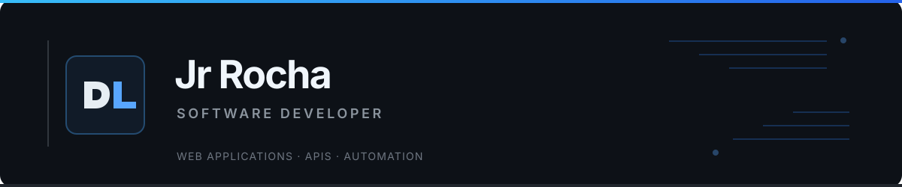

  

  <strong>Software Developer</strong> &nbsp;·&nbsp; Web Applications &nbsp;·&nbsp; APIs &nbsp;·&nbsp; Automation

I build web applications and connected systems, with most of my work focused on JavaScript and TypeScript. I enjoy taking a project from its interface through to the API and the integrations behind it.

Desenvolvo aplicações web e sistemas integrados, principalmente com JavaScript e TypeScript. Gosto de cuidar do projeto como um todo: da interface às APIs e integrações que fazem tudo funcionar.

---

## Projects

### [Fluxo Recruitment](https://github.com/eujrrocha/fluxo-recruitment)

A recruitment platform for Discord communities, with Discord OAuth2 login, candidate applications, an admin dashboard and notifications.

**Stack:** React · TypeScript · Tailwind CSS · Node.js · Express · MongoDB

### [Tokly](https://github.com/eujrrocha/tokly-site)

A lightweight website for a Telegram bot. Includes the service page, privacy policy, terms of use and responsive layouts.

**Stack:** HTML · CSS

## Technologies

  
  
  
  
  
  
  
  
  
  

---

[All repositories →](https://github.com/eujrrocha?tab=repositories)
