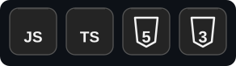
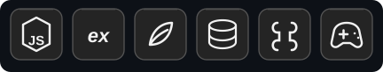
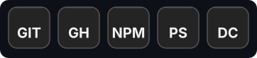

<h1>Jr Rocha</h1>

<strong>Desenvolvedor Full Stack</strong> focado em aplicações web, APIs, automações e integrações com Discord.

<em>Full Stack Developer focused on web applications, APIs, automation and Discord integrations.</em>

<h2>Linguagens</h2>

<h2>Backend &amp; Banco de Dados</h2>

<h3>Experiência</h3>
<ul>
  <li>Desenvolvimento de APIs REST</li>
  <li>Integração com Discord OAuth2 e webhooks</li>
  <li>Bots e automações para Discord</li>
  <li>Autenticação e autorização com JWT</li>
  <li>Painéis administrativos e dashboards</li>
  <li>Atualizações em tempo real com Server-Sent Events (SSE)</li>
  <li>Integração com bancos de dados e serviços externos</li>
  <li>Notificações por Discord e e-mail</li>
</ul>

<h2>Frontend &amp; Web</h2>

<h3>Desenvolvimento</h3>
<ul>
  <li>Interfaces responsivas</li>
  <li>Componentização com React</li>
  <li>Estilização com Tailwind CSS</li>
  <li>Integração entre frontend e backend</li>
  <li>Formulários e dashboards web</li>
</ul>

<h2>Ferramentas</h2>

<h2>Projetos em destaque</h2>
<ul>
  <li><strong><a href="https://github.com/eujrrocha/fluxo-recruitment">Fluxo Recruitment</a></strong> — plataforma de recrutamento com autenticação Discord, API e painel administrativo.</li>
  <li><strong><a href="https://github.com/eujrrocha/tokly-site">Tokly</a></strong> — site oficial de um bot do Telegram, com páginas de privacidade e termos de uso.</li>
</ul>

<a href="https://github.com/eujrrocha?tab=repositories">Ver todos os repositórios</a>

<h2>Contato</h2>

<a href="https://github.com/eujrrocha">GitHub · @eujrrocha</a>

<em>Jr Rocha</em>

