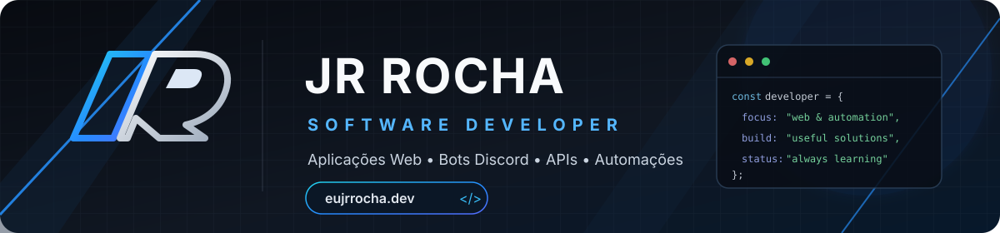
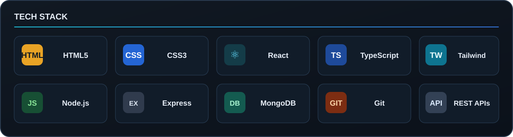
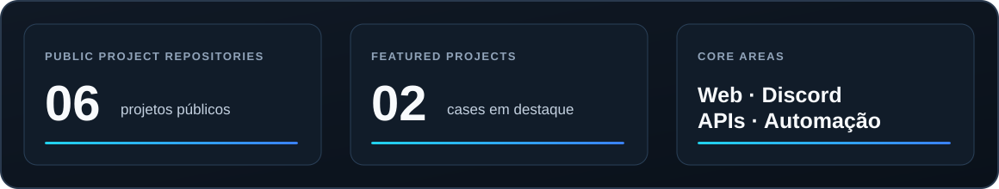

  

  <a href="https://github.com/eujrrocha"><strong>GitHub</strong></a>
  &nbsp;·&nbsp;
  <a href="https://github.com/eujrrocha?tab=repositories"><strong>Projetos / Projects</strong></a>

<h1 align="center">Olá, eu sou Jr Rocha 👋</h1>

  Desenvolvedor focado na criação de aplicações web, bots para Discord, APIs, integrações e automações.
  Gosto de transformar ideias em soluções funcionais, com atenção à experiência, organização e detalhes.

  <em>Software developer focused on web applications, Discord bots, APIs, integrations and automation.
  I enjoy turning ideas into useful solutions with attention to usability and detail.</em>

---

## 🧑‍💻 Sobre mim | About me

- 🇧🇷 Desenvolvedor do Brasil, construindo projetos e aprendendo continuamente.
- ⚙️ Interesse em aplicações web, automação de processos e integração entre serviços.
- 🔌 Experiência prática com APIs, dashboards e ferramentas conectadas ao Discord.
- 🚀 Buscando escrever código organizado e criar soluções úteis.

<em>
  Based in Brazil, building projects and continuously learning. Interested in web apps,
  process automation and service integrations, with hands-on work on APIs, dashboards
  and Discord-connected tools.
</em>

## 🛠️ Tecnologias | Tech stack

  

## 🚀 Projetos em destaque | Featured projects

<table>
  <tr>
    <td width="50%" valign="top">
      <h3><a href="https://github.com/eujrrocha/tokly-site">Tokly — Website</a></h3>
      
Site estático para um bot do Telegram, com apresentação do serviço, páginas de privacidade e termos de uso.

      
<em>Static website for a Telegram bot, including service information, privacy and terms pages.</em>

      
<strong>HTML · CSS</strong>

      
<a href="https://github.com/eujrrocha/tokly-site">Ver repositório / View repository →</a>

    </td>
    <td width="50%" valign="top">
      <h3><a href="https://github.com/eujrrocha/fluxo-recruitment">Fluxo Recruitment</a></h3>
      
Plataforma de recrutamento integrada ao Discord, com formulário de candidatura, API e painel administrativo.

      
<em>Discord-integrated recruitment platform with an application form, API and admin dashboard.</em>

      
<strong>React · TypeScript · Tailwind CSS · Node.js · Express · MongoDB</strong>

      
<a href="https://github.com/eujrrocha/fluxo-recruitment">Ver repositório / View repository →</a>

    </td>
  </tr>
</table>

  <a href="https://github.com/eujrrocha?tab=repositories">Veja todos os repositórios / Explore all repositories →</a>

## 📌 Visão geral | Profile overview

  

---

## 📫 Conecte-se | Connect

  <a href="https://github.com/eujrrocha"><strong>GitHub · @eujrrocha</strong></a>

  Feito com dedicação por Jr Rocha · Built with care by Jr Rocha

